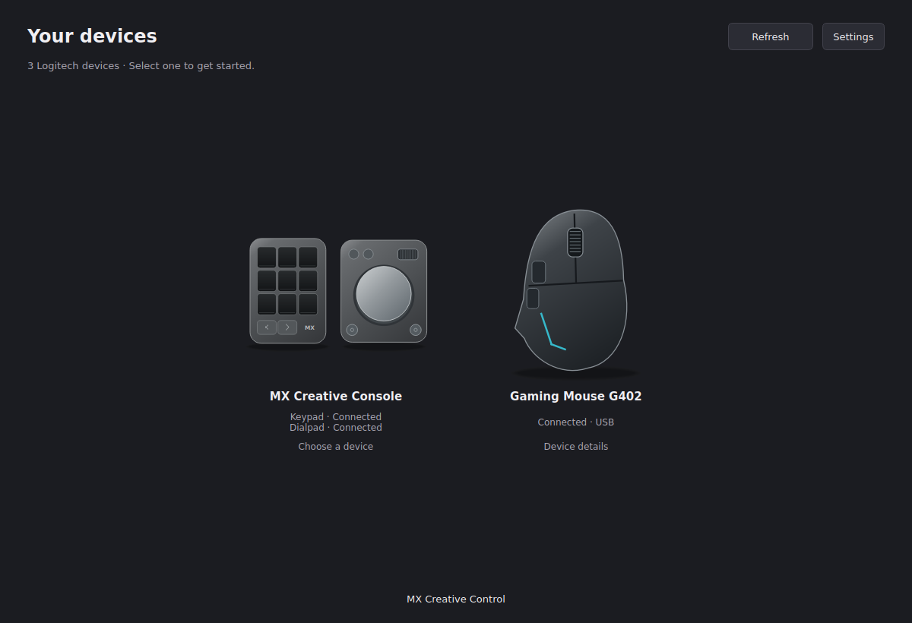
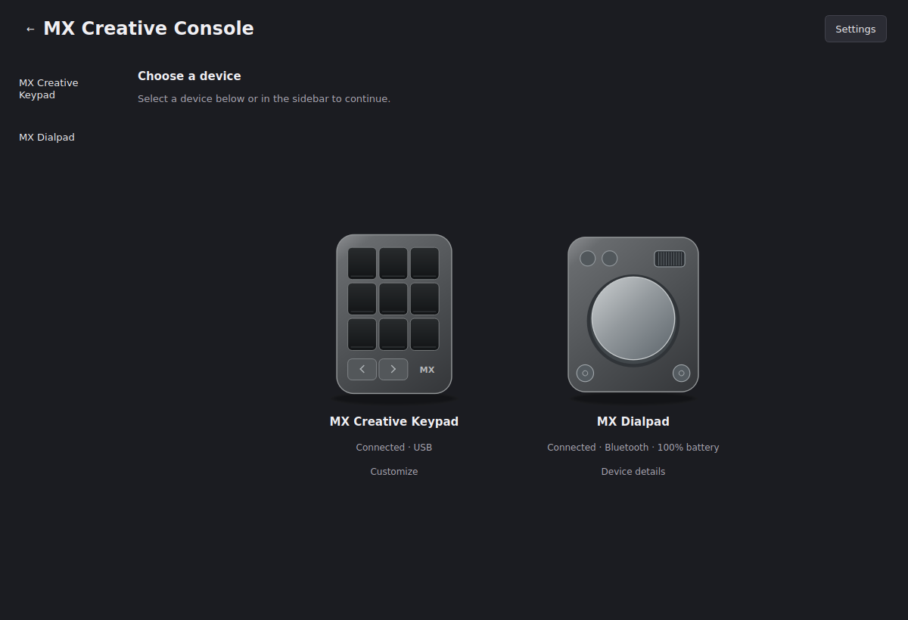

# MX Creative Control

A lightweight Ubuntu app for the Logitech MX Creative **Keypad**. Launch your apps from its nine LCD keys, use their original icons, and switch to shortcuts for the app you are working in.



The live device home screen, with the keypad and dialpad grouped as MX Creative Console.

This is an independent community project, not Logitech's Logi Options+ software. The home screen lists connected Logitech devices; customization is available for the MX Creative Keypad only.

## Features

- **Device home screen:** the keypad and dialpad share an MX Creative Console card. Open it to choose a component, then select the keypad for its Keys editor. The dialpad and other connected Logitech devices show connection details without offering unsupported controls. Refresh and Settings icons stay at the bottom left on every page; Settings opens global preferences.
- **Connection indicators:** each device has a green dot when connected, red when disconnected, and blinking yellow while searching. On both the home screen and Console component selector, a reported battery percentage appears beside the dot beneath the device; devices without battery data show only the dot. Hover for connection details. Devices seen during the open window's session remain visible after disconnecting; unconfirmed connections use steady yellow.
- **Original app icons:** artwork comes from installed desktop entries and icon themes, fills the key with a narrow black border, and has no added white tile. Keys show icons only by default, with optional labels and neutral placeholders for missing artwork.
- **Small background worker:** Rust handles the keypad, virtual shortcut input, panel icon and X11 focus events. The native Qt settings window runs only while open.
- **System, light or dark appearance:** follows your desktop by default, with an immediate override in Settings. The window and panel use the same keypad icon.
- **Installed-app discovery:** scan standard desktop entries, Snap and Flatpak applications; choose apps or Screenshot for the launcher.
- **Focus or launch:** on X11, an app key brings an existing matching window forward; it launches the app only when no matching window exists.
- **Compact, reorderable launcher:** available Apps fill keys left-to-right, top-to-bottom. Drag a key to insert it elsewhere; the other keys shift and the keypad updates immediately.
- **Editable shortcut profiles:** manage profiles for assigned apps in Applications, edit their nine actions in the UI, or import declarative JSON from `shortcuts/config/`.
- **Automatic or manual pages:** on X11, an app activated from a keypad key shows its assigned shortcuts while it stays active, then returns to Apps when focus leaves. Arrow buttons, manual profiles and the automatic-switching preference remain in control.
- **Portable settings and explicit permissions:** export/import layouts and profiles, opt into sign-in startup, and use Ubuntu's authentication dialog when device access needs repair.

Closing settings leaves the worker running. Opening settings from the panel icon or app launcher reconnects it, reloads the layout and selects the Apps page. **Quit** in the panel menu stops the worker. One measured idle sample used about **5.5 MiB RAM** with settings closed; see [validation and resource measurements](docs/VALIDATION.md) for conditions and limits.

## Requirements

- **Validated target:** Ubuntu 24.04, amd64, with the keypad connected over USB (`046d:c354`).
- **Building/development:** Python 3.12, Rust **1.89 or newer** with Cargo, Git, and the Ubuntu build dependencies below.
- **Desktop:** X11 for automatic app switching. GNOME needs StatusNotifier/AppIndicator support to display the panel icon; settings also opens from the app launcher.
- **Input access:** the active desktop user needs access to the keypad and `/dev/uinput`. The package supplies the rules and a fixed permission-repair helper.

Other distributions, architectures and Ubuntu versions need separate validation. Shortcuts use physical US-layout key codes; adapt profiles for other layouts or custom application bindings.

## Build and install

The repository contains source and packaging tools. Built `.deb` files and `dist/` are not tracked; build the package before following the install command.

Install Rust 1.89 or newer with Cargo, then prepare the Ubuntu build tools:

```sh
sudo apt install git build-essential pkg-config python3 python3-pip python3-venv \
  libdbus-1-dev libudev-dev libx11-dev dpkg-dev
git clone https://github.com/REGATTE/logi_ms_cc.git
cd logi_ms_cc
```

Fetch the pinned Qt runtime and locked Rust dependencies, then build and check the package:

```sh
scripts/prepare-runtime.sh --download
cargo fetch --locked --manifest-path worker/Cargo.toml
scripts/build-deb.sh
python3 scripts/check-package.py dist/mx-creative-control_0.2.0_amd64.deb
sudo apt install ./dist/mx-creative-control_0.2.0_amd64.deb
mx-creative-control
```

The package bundles PySide6-Essentials and Shiboken **6.10.2** privately. Installation needs no pip setup; apt installs declared Ubuntu system dependencies. After the fetch steps, package assembly uses local inputs with Cargo's lockfile in offline mode. Copy the built `.deb` to another Ubuntu 24.04 amd64 PC to install it there. [Installation details](docs/INSTALL.md) cover offline requirements, permissions, services and removal.

Connect the keypad, install the applications you want to launch, and open **MX Creative Control**. Select **MX Creative Console** on the device home screen, then choose the keypad. Close other controllers such as OpenLogi or Solaar before using it so they do not compete for the keypad.

The app and worker run as your normal user. Installation or **Settings → Permissions & connection → Set up device permissions** requires administrator authentication. `/dev/uinput` access also lets other programs running as that user create virtual input devices; the dialog explains this access. Permission repair uses the installed root-owned helper, never a script from a writable checkout.

## Configure the keypad




Live console selection and keypad editor on the Ubuntu workstation.

1. Select **MX Creative Console** on the home screen, then choose the keypad by clicking its image. Under **Keys**, select a key, choose an installed app or Screenshot, and press **Apply to key** at the bottom of the rounded right-hand inspector. The picker includes all installed apps; applying a key preserves that app's existing shortcut assignment.
2. Drag an Apps key onto another to insert it at that position and shift the other keys. Dropping onto a blank key appends it after the other apps. Reorders save and reload the keypad immediately; shortcut slots keep their assigned positions.
3. **Applications** shows rounded cards for apps and Screenshot currently assigned to the keypad, in key order, with each app listed once. Each card shows its original icon and assigned keys. Search by name, choose a shortcut profile, **Import** a file, or **Edit** shortcuts (**Set up** when none are assigned). **Rescan apps** refreshes installed apps; add newly found apps through the picker under **Keys**.
4. On X11, press an app key to focus its existing window or launch it. With automatic switching enabled and a profile assigned, the keypad shows that app's shortcuts while it is active and returns to Apps when focus leaves. Apps without a profile stay on Apps. In the editor, the app icons above the keypad select their shortcuts. The inspector's bottom actions include **Import shortcuts**, **Edit shortcuts**, **Use shortcuts on keypad**, and **Follow active app**. Arrow buttons and manual shortcut choices override automatic paging; **Follow active app** restores automatic matching.
5. Use the back controls to return to the console or all devices. The Settings gear at the bottom left of every page opens **Settings → Appearance**, where you can choose **System setting**, **Light**, or **Dark**. System setting follows desktop changes automatically. Settings also contains **Permissions & connection**, labels, sign-in startup and configuration export. The keypad sidebar contains only **Keys** and **Applications**.

Device discovery reads USB/HID inventory and connected Bluetooth device metadata while the settings window is open. It does not pair devices or change their configuration. Use the shared Refresh icon after connecting a device; the inventory also refreshes periodically. If multiple supported keypads are connected, the editor asks you to leave one connected so configuration has a single target.

First-run choices target ChatGPT, VS Code, Lark, Firefox, Warp and Screenshot. Available apps and Screenshot fill the Apps page without gaps, left-to-right and top-to-bottom. Configured apps that are missing on this PC remain in settings for portability but do not leave holes between visible keys. A browser shortcut/PWA must provide a desktop entry to appear in discovery. ChatGPT and Lark profiles contain conventional editing actions; app-specific bindings can be added in the editor.

Bundled profiles are in [`shortcuts/config/`](shortcuts/config/). User profiles belong in:

```text
~/.config/mx-creative-control/shortcuts/config/
```

`XDG_CONFIG_HOME` is respected. Import a new file through the app, or copy it into that directory and rescan. Profiles contain labels, icon names and key combinations; they cannot contain scripts or shell commands. See [the JSON format and example](docs/PROFILES.md) and [shortcut references](shortcuts/README.md). When moving settings, desktop IDs can differ between Snap, Flatpak and distro installations; reassign the corresponding installed app where needed. Original artwork is resolved on the destination PC.

## Develop and test

From the cloned repository, using the requirements above:

```sh
python3 -m venv .venv
.venv/bin/python -m pip install -e '.[test]'
cargo build --manifest-path worker/Cargo.toml --locked
MXCC_WORKER="$PWD/worker/target/debug/mxcc-worker" scripts/run-dev.sh
```

Source runs need the same desktop libraries and device permissions as an installed package. The permission-repair dialog becomes available after package installation. Quit an already running tray worker before testing a rebuilt worker. `scripts/run-dev.sh` selects the checkout's virtual environment; the worker remains independent of the settings process under Ubuntu's user-session service manager.

```sh
QT_QPA_PLATFORM=offscreen .venv/bin/python -m pytest
cargo test --manifest-path worker/Cargo.toml --locked
cargo fmt --manifest-path worker/Cargo.toml --check
cargo clippy --manifest-path worker/Cargo.toml --all-targets --locked -- -D warnings
```

Automated tests do not access hardware. They cover app discovery, profiles and imports, runtime compilation, real offscreen Qt interactions, permission routing, worker recovery, HID packets, shortcut keys and private IPC. [VALIDATION.md](docs/VALIDATION.md) records separate physical-device checks and current limitations. To produce a clean source archive, run `python3 scripts/source-archive.py`.

## Current limits

- Wayland supports app launching, virtual shortcut input and manual profiles; focusing existing windows and automatic app/page detection are not implemented. Use an X11 session for those features.
- Only the MX Creative Keypad can be configured. Other detected Logitech devices, including the dialpad, have a details page only. Multiple connected keypads cannot be configured independently.
- Applications must expose desktop entries to be discovered. Profiles assume default app shortcuts, which can vary by version, focused widget or user configuration.
- Validation covers one Ubuntu 24.04 amd64 workstation and physical keypad. Other environments need testing before being treated as supported.

## Repository layout

```text
src/mxcc/          Qt settings, discovery, profiles, runtime configuration
worker/            Rust keypad worker, input, focus tracking, tray and IPC
shortcuts/config/  Bundled JSON shortcut profiles
packaging/         Desktop entry, service, permissions and runtime notices
scripts/           Development launcher, package checks and build tools
tests/             Python and offscreen GUI tests
docs/              Installation, profiles, interface contract and validation
```

## License and attribution

Project code is [MIT licensed](LICENSE). The reverse-engineered keypad protocol builds on OpenLogi and `node-logitech-mx-creative-console`; their notices and attribution are in [worker/THIRD_PARTY.md](worker/THIRD_PARTY.md). Qt and Shiboken retain their upstream licenses, documented in [packaging/THIRD_PARTY.md](packaging/THIRD_PARTY.md). Installed app icons and trademarks belong to their respective owners. The device-first interface references are documented in [UI design references](docs/UI-REFERENCES.md); product illustrations are drawn locally in Qt.
